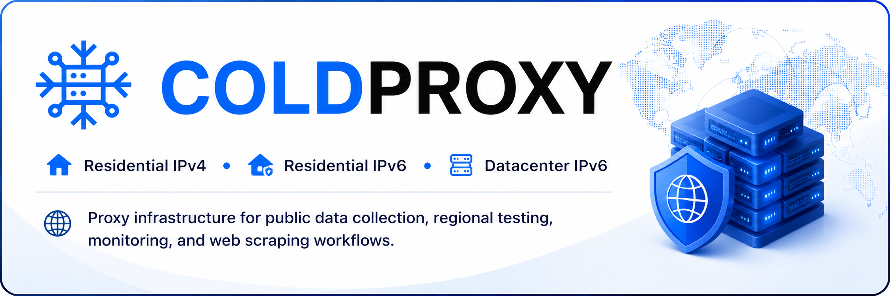
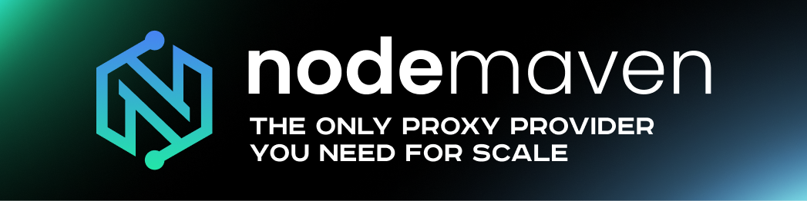

<p align="center"><strong>English</strong> | <a href="./README_zh-CN.md">简体中文</a></p>

<p align="center">
  <a href="https://webclaw.io">
    
  </a>
</p>

<h1 align="center">webclaw</h1>

<p align="center">
  <strong>Turn websites into clean markdown, JSON, and LLM-ready context.</strong><br/>
  <sub>CLI, MCP server, REST API, and SDKs for AI agents and RAG pipelines.</sub>
</p>

<p align="center">
  <a href="https://github.com/0xMassi/webclaw/stargazers"></a>
  <a href="https://github.com/0xMassi/webclaw/releases"></a>
  <a href="https://github.com/0xMassi/webclaw/blob/main/LICENSE"></a>
  <a href="https://www.npmjs.com/package/create-webclaw"></a>
</p>

<p align="center">
  <a href="https://discord.gg/KDfd48EpnW"></a>
  <a href="https://x.com/webclaw_io"></a>
  <a href="https://webclaw.io"></a>
  <a href="https://webclaw.io/docs"></a>
</p>

<p align="center">
  <a href="https://trendshift.io/repositories/24218?utm_source=trendshift-badge&amp;utm_medium=badge&amp;utm_campaign=badge-trendshift-24218" target="_blank" rel="noopener noreferrer"></a>
</p>

<p align="center">
  
</p>

---

Most web scraping tools give your agent one of two bad outputs:

- a blocked page, login wall, or empty app shell
- raw HTML full of nav, scripts, styling, ads, and duplicated boilerplate

[webclaw.io](https://webclaw.io) is the hosted web extraction API for webclaw. This repo contains the open-source CLI, MCP server, extraction engine, and self-hostable server.

webclaw turns a URL into clean content your tools can actually use.

```bash
webclaw https://example.com --format markdown
```

```md
# Example Domain

This domain is for use in illustrative examples in documents.

You may use this domain in literature without prior coordination or asking for permission.
```

Use it from the terminal, wire it into Claude/Cursor through MCP, call the hosted API from your app, or self-host the OSS server.

---

## Install

### Agent setup

The fastest way to connect webclaw to Claude Code, Claude Desktop, Cursor, Windsurf, OpenCode, Codex CLI, and other MCP-compatible tools:

```bash
npx create-webclaw
```

The installer detects supported clients and configures the MCP server for you.

### Homebrew

```bash
brew tap 0xMassi/webclaw
brew install webclaw
```

### Prebuilt binaries

Download macOS, Linux, and Windows binaries from [GitHub Releases](https://github.com/0xMassi/webclaw/releases).

#### Windows (x64)

The prebuilt ZIP is the easiest installation and does not require Rust. On the
[v0.6.22 release page](https://github.com/0xMassi/webclaw/releases/tag/v0.6.22),
download `webclaw-v0.6.22-x86_64-pc-windows-msvc.zip`. Extract it in File Explorer,
open PowerShell in the extracted folder containing `webclaw.exe`, and run:

```powershell
.\webclaw.exe --version
.\webclaw.exe https://example.com --format markdown
```

PowerShell requires the `.\` prefix for programs in the current directory.
Add that directory to your user PATH only if you want to run `webclaw` from
other folders. If Windows reports a missing Visual C++ runtime DLL, install the
Microsoft Visual C++ Redistributable for x64. The ZIP contains x64 binaries;
Windows ARM64 is not covered by the native installation check.

To build from source on Windows, install Rust with the `x86_64-pc-windows-msvc`
toolchain, Visual Studio Build Tools with **Desktop development with C++** and
the Windows SDK, Git, CMake 3.22 or newer, LLVM (including `libclang.dll`), and
NASM. Open a fresh Developer PowerShell for Visual Studio after installation.
Ensure CMake and NASM are on PATH and set `LIBCLANG_PATH` to your LLVM `bin`
directory if bindgen cannot find it, for example:

```powershell
$env:LIBCLANG_PATH = "C:\Program Files\LLVM\bin"
cargo install --git https://github.com/0xMassi/webclaw.git --tag v0.6.22 --locked webclaw-cli
webclaw --version
```

The Cargo package is `webclaw-cli`; the executable is `webclaw`. These packages
are installed from Git, not crates.io. A first source build can take several
minutes. The Windows CI workflow checks the Git installation and published ZIP
on a hosted runner with preinstalled build tools; it does not model a clean PC.
Linux containers, including Docker on macOS, do not validate Windows support.

### Docker

```bash
docker run --rm ghcr.io/0xmassi/webclaw https://example.com
```

### Cargo

```bash
cargo install --git https://github.com/0xMassi/webclaw.git --tag v0.6.22 --locked webclaw-cli
cargo install --git https://github.com/0xMassi/webclaw.git --tag v0.6.22 --locked webclaw-mcp
```

If building from source fails because native build tools are missing, install the platform prerequisites:

| OS | Command |
| --- | --- |
| Debian / Ubuntu | `sudo apt install -y pkg-config libssl-dev cmake clang git build-essential` |
| Fedora / RHEL | `sudo dnf install -y pkg-config openssl-devel cmake clang git make gcc` |
| Arch | `sudo pacman -S pkg-config openssl cmake clang git base-devel` |
| macOS | `xcode-select --install` |

### Python

The [`python/`](python/) directory builds a Python package that bundles the `webclaw` binary and calls it from Python: `scrape`, `select`, `tables`, `find_text`, `similar`, `crawl`, `map` and `screenshot`, with no API key and no Python dependencies.

```bash
cd python && uv build --wheel && pip install dist/webclaw_cli-*.whl
```

```python
import webclaw_cli as wc

md = wc.scrape("https://example.com", "llm")
titles = wc.select("https://books.toscrape.com", css="h3 a::attr(title)")
for page in wc.crawl("https://quotes.toscrape.com", max_pages=10):
    print(page["url"])
```

See [python/README.md](python/README.md) for every function and option.

---

## Quick Start

### Scrape one page

```bash
webclaw https://stripe.com --format markdown
```

### Return LLM-optimized text

```bash
webclaw https://docs.anthropic.com --format llm
```

### Keep only the main content

```bash
webclaw https://example.com/blog/post --only-main-content
```

### Include or exclude selectors

```bash
webclaw https://example.com \
  --include "article, main, .content" \
  --exclude "nav, footer, .sidebar, .ad"
```

### Pick values with CSS selectors or XPath

```bash
webclaw https://books.toscrape.com --select "h3 a::attr(href)"
webclaw https://books.toscrape.com --select "article.product_pod" \
  --field "title=h3 a::attr(title)" --field price=.price_color
```

`--select` prints a JSON array of what the selector matches: each element's text, or an attribute or the element's HTML when the selector ends in `::attr(NAME)` or `::html`. Links in `href` and `src` come back absolute. With `--field NAME=SELECTOR`, each match becomes a JSON object whose fields run inside it, taking the first value or `null`. Pages that need JavaScript render first, as with extraction.

```bash
webclaw https://books.toscrape.com --xpath "//li[@class='next']/a/@href"
webclaw https://books.toscrape.com --xpath "//article[@class='product_pod']" \
  --field "title=.//h3/a/@title" --field "price=.//p[@class='price_color']"
```

`--xpath` takes an XPath 1.0 expression instead, over the same parsed page: elements and text nodes give their text, attributes their value, and `count()` or `string()` style expressions one value. With `--xpath`, each `--field` is an expression evaluated from the match, so it usually starts with `.`. The MCP `select` tool takes `xpath` in place of `selector`.

### Data tables as JSON

```bash
webclaw "https://en.wikipedia.org/wiki/List_of_S%26P_500_companies" --tables
```

`--tables` prints the page's data tables as a JSON array, each with its `caption` (when it has one), `headers` and `rows` of cell text. A cell that spans several rows or columns repeats its text in each one, so every row has one value per column. Stacked header rows are joined per column with ` / `, as in `Population / % of world`. The MCP `select` tool takes `tables: true` in place of a selector.

Header rows are the rows of `<thead>` and the leading rows made only of `<th>`; a leading row that is one cell across the whole table becomes the caption. These tables are skipped as page layout:

- tables marked `role="presentation"` or `role="none"`;
- tables with fewer than two columns of text;
- tables without a header row that have a single body row, wrap another table, hold only links, or hold paragraphs, lists or other blocks in a row of more than one cell.

Text hidden with `hidden`, an inline `display:none` or `<template>` is left out. Text hidden by a stylesheet is kept, because pages are not styled. A cell keeps its first 64 KB of text, and a very large table is cut short with `"truncated": true`. Once the tables on a page reach 64 MB, the tables after that are left out.

### Find elements by text, or everything like one example

```bash
webclaw https://books.toscrape.com --find-text "tipping the"
webclaw https://books.toscrape.com --find-regex '^£5\d\.\d\d$'
webclaw https://books.toscrape.com --find-text "Tipping the Velvet" --similar
```

`--find-text` prints the elements in the page body whose visible text contains the text, any case, as `{"selector", "text"}` objects. Each match is the deepest element holding the text, so text split by inline tags still matches, and its `selector` is the element's path from the nearest ancestor with a unique id, or from the root. That path picks the element alone, except on pages nested more than 64 levels deep with no such id, where it keeps only the last 64 steps and can pick more. `--exact` matches the whole text, `--case-sensitive` matches letter case, and `--find-regex` takes a regular expression instead.

`--similar` takes the first element that `--find-text`, `--find-regex`, `--select` or `--xpath` picks as an example and returns every element like it on the page, such as the other items of a list, grid or table, with one CSS selector that picks them all. When the example selector ends in `::attr(NAME)` or `::text`, or the XPath picks a text or attribute node, the element holding it is the example:

```json
{
  "selector": "article.product_pod > h3 > a",
  "matches": [
    { "selector": "html > body > ... > li:nth-of-type(1) > article > h3 > a", "text": "A Light in the ..." },
    ...
  ]
}
```

Reuse the selector with `--select`, or add `--field` to get records straight away; with `--similar` the fields are CSS and the output is `{"selector", "records"}`. Pick the item itself as the example (for instance `--select "article.product_pod" --similar`) when the fields live inside it. The MCP `select` tool takes `text` or `regex` (with `exact` and `case_sensitive`) and `similar` the same way. One call takes one picker: `--select`, `--xpath`, `--tables`, `--find-text` or `--find-regex` (in MCP: `selector`, `xpath`, `tables`, `text` or `regex`), and `--similar` and `--field` do not apply to tables.

### Keep only what answers a question

```bash
webclaw "https://en.wikipedia.org/wiki/Rust_(programming_language)" -f llm \
  --query "Who began the language as a personal project?"
```

`--query` (and `query` on the MCP `scrape` tool) scores each paragraph, list, table and code block against the question and keeps the best ones under their headings, so an agent reads the answer instead of the whole page. The page comes back unchanged when no block shares a word with the question.

### Chunks for retrieval

```bash
webclaw https://doc.rust-lang.org/book/ch03-01-variables-and-mutability.html --chunk 256
webclaw https://quotes.toscrape.com --crawl --depth 1 --chunk 512 --chunk-overlap 50
```

`--chunk` prints the page as chunks for a search index or a RAG pipeline, one JSON object per line (one JSON array with `-f json`): `url`, `index`, `heading_path` (the headings in effect where the chunk starts, outermost first), `tokens` and the chunk's markdown `text`. Chunks are built from whole paragraphs, lists, tables and code blocks and stay under about the given number of tokens. A block too big for one chunk is cut at line breaks, then at sentence ends, then between words, and text with no spaces between characters: a code block is reopened in each piece and a table repeats its header row. Token counts are estimates made without a tokenizer. On the benchmark pages (prose, docs, code, tables and nine languages), for nine chunks in ten cl100k counted 0.77 to 1.12 times the estimate and o200k 0.72 to 0.97 times; 4.5% of chunks came out above the size asked for in cl100k tokens, and 0.5% in o200k tokens. `--chunk-overlap` repeats up to that many tokens from the end of each chunk at the start of the next. With several URLs or `--crawl`, each page is chunked on its own. The MCP `scrape` tool takes `chunk` and `chunk_overlap` and returns the chunks as a JSON array; `crawl` takes them too and returns an object with the crawl counts, the pages that failed and the chunks.

### Links as numbered citations

```bash
webclaw https://en.wikipedia.org/wiki/Web_scraping --citations
```

`--citations` moves every link and image URL out of the markdown into a numbered list at the end, written as markdown footnotes: `[Data scraping](https://...)` becomes `Data scraping[^1]`, an image becomes `![alt][^2]`, and the page ends with `## Links` and one `[^1]: https://...` per URL. Numbers follow the order in which URLs first appear, a URL used twice keeps its first number, and numbering starts after any numbered footnotes the page already has. With several URLs or `--crawl`, pages printed together keep counting, so a number means one URL in the whole output; with `--output-dir`, `-f json` or `jsonl` each page counts on its own.

Some things stay as they are: code blocks and inline code, reference-style links (`[text][id]`), autolinks (`<https://...>`) and raw HTML links. Links to a spot on the same page (`#section`) and `javascript:` links keep their text and lose the URL. A cited image is no longer an image to a markdown renderer (GitHub shows `![alt]` as text); its URL is in the list. With `-f markdown`, a page's `## Structured Data` block comes after the list.

On the 63 benchmark pages fetched live, the body before the list came out at about half the tokens of the plain markdown, and the whole output, list included, at 10.7% fewer tokens in total. That total comes mostly from link-heavy pages such as Wikipedia articles: the 5 pages that saved most hold 68% of the saving, the median page saved 2.5%, and 18 of 63 pages came out a little longer. Golden facts were the same with and without it. Reach for it to cite sources by a short, stable id or to keep URLs out of the text, not as a general way to cut tokens.

It works with `-f markdown` and with the markdown inside `-f json` and `jsonl`, for one URL, several or `--crawl`. It is refused with `--chunk` and with modes that print no page markdown (`-f text`, `llm` or `html`, `--select`, `--map`, `--brand`, `--diff-with`, `--watch`, the LLM modes and the like). The MCP `scrape`, `crawl` and `batch` tools take `citations: true`, and `webclaw_core::to_citations` (or `to_citations_after`, to keep counting across pages) does the same for any markdown.

### Reuse fetched pages

```bash
webclaw https://example.com --cache          # fetch once, answer later runs from disk
```

`--cache` keeps every successful page in `~/.cache/webclaw` (or `WEBCLAW_CACHE_DIR`), readable by you only, and answers later fetches of the same URL with the same browser profile and headers from there, with no network request. Crawls and batches use it page by page. Entries never expire; delete the directory to refresh. Error responses, challenge pages and `Set-Cookie` headers are never stored. The cache keeps the HTTP response only: a page that needs JavaScript still renders in the browser, which loads its scripts over the network.

### Keep a web archive

```bash
webclaw https://example.com --warc page.warc.gz
webclaw https://docs.example.com --crawl --depth 2 --warc site.warc.gz > site.md
```

`--warc FILE` keeps every HTTP response webclaw fetches, with the request that asked for it, in a WARC file, the web archive format of ISO 28500 that web archives and replay tools read. The output goes where it always goes; the archive is written beside it. A name that ends in `.gz` gzips each record on its own, as `.warc.gz` files do. It works with one URL, several, `--crawl` (robots.txt and redirect responses included) and `--map` (the sitemaps it tried). Records are written as they arrive, so a crawl you stop keeps every page it fetched. A file that already exists is added to, never overwritten: each run starts with its own `warcinfo` record, and a WARC file made of several runs is still one valid WARC file. A file that ends inside a record, as a run stopped while writing can leave it, is refused, since records added after the cut would be unreadable; give `--warc` a new file then. Each record carries SHA-1 digests of its content.

The response is kept as webclaw's HTTP client hands it over, which is decoded: a compressed body is stored decompressed, without its `Content-Encoding`, `Content-Length` and `Transfer-Encoding` headers, and an HTTP/2 response gets an HTTP/1.1 status line. Each run's `warcinfo` record says so, and every record points at it. Replay tools read such records fine, but the payload digests are those of the decoded bodies, so they will not match, for deduplication, a copy of the same page that another archiver stored still compressed. The request record lists the headers webclaw sent, `-H` and `--cookie` values included, so keep the file as safe as those values; cookies a site set during the run are not listed. Every redirect gets its own response and request record, the redirect responses included, in a crawl or not; cookies and credentials you pass are not sent on to another site, as without `--warc`. Pages a browser renders are not in it, so `--warc` refuses `--render always`, `--actions` and `--scroll`; with `--render auto`, the HTTP response of a page that then gets rendered is kept. It also refuses `--cache`, whose answers never touch the network, and `--cloud`. Use `--save-mhtml` to keep a rendered page.

### Render JavaScript pages

Build with the `browser` feature (`cargo build --release --features browser`) and webclaw renders pages in your local Chrome when the plain HTTP response has no content yet:

```bash
webclaw https://hn.algolia.com                    # --render auto: HTTP first, Chrome only when needed
webclaw https://example.com --render always --wait-for "#app li"
webclaw https://example.com --cdp-url ws://localhost:9222/devtools/browser/<id>   # use a running browser
```

`auto` renders when the page loads scripts and the HTTP response has almost no text, or little text next to an empty app root or a "please enable JavaScript" notice, and it keeps the rendered result only when it has more content.

The browser webclaw launches presents itself as regular Chrome: every page, frame and worker sends and reads your Chrome's own User-Agent, without the "Headless" that headless Chrome adds, so it matches the client hints Chrome sends. Some sites serve a headless browser an error or a pre-rendered page. A browser you connect with `--cdp-url` keeps its own User-Agent.

What a rendered page can reach, in the browser webclaw launches:

- no HTTP request from the page, its frames or its workers, redirects included, reaches a private, loopback or link-local address;
- WebSockets to those addresses are refused, though the TCP connection opens first. Behind a proxy, WebSockets to anything but loopback go through the proxy, so they are only as safe as the proxy;
- speculative prefetching and preconnects are off;
- WebRTC sends no UDP, though a TURN server over TCP can still open a connection to a local port;
- without a proxy, a render fails when the page's document came from a private address, so DNS rebinding cannot return local content. The request itself still goes out, and popups are not checked.

Behind a proxy, the proxy resolves host names itself and the document check is off, so HTTP too is only as safe as the proxy. Service workers are not tested. A browser you connect with `--cdp-url` is checked page by page and your other tabs are left alone, but the frames, workers, WebSockets, WebRTC and speculative prefetching of the pages webclaw renders there are not covered.

`--block images,fonts,media` skips those resources while a page renders for its content. Stylesheets always load, since many apps fetch CSS on demand and break without it. Scripts and the data they fetch still load, so most pages keep all their text and download about 40% less. A page that shows some text only after a font or an image has loaded (through `document.fonts.load()`, `FontFace.load()`, an image's `onload` or `decode()`) loses that text when you block it. We found no such page among the real sites we tested, but compare with and without `--block` on yours. Rendering is not much faster, since webclaw already stops waiting once the text settles, so blocking stays off unless you ask. Screenshots and PDFs always load everything. The MCP `scrape` and `crawl` tools take the same list as `block`.

`--screenshot page.png` saves the rendered page's 1280x720 viewport, `--full-page` the whole page, and a `.jpg` name gives a JPEG. The MCP `screenshot` tool returns the same image to the agent.

`--save-pdf page.pdf` (or `-` for stdout) prints the rendered page to a PDF through the browser's print engine: every page, with the site's print styles and Chrome's default margins, without the accessibility tags some browsers add. `--paper a4` changes the US Letter default, `--landscape` turns the paper sideways, `--print-background` keeps background colors and images, and `--scale 0.8` zooms the content (0.1 to 2). It takes `--wait-for`, `--actions` and `--scroll` like any render, and loading plus printing must fit in `--timeout`. Chrome lays out the whole page to print it, so a very long page, such as a full web standard on one page, can take several GB of memory in Chrome while it prints. The flag is not `--pdf` because `--pdf-mode` is about reading PDFs you fetch, not making them. The MCP `screenshot` tool returns the same PDF with `format: "pdf"`, as an `application/pdf` resource of up to 10 MiB, and takes `paper`, `print_background` and `actions` the same way.

`--save-mhtml page.mhtml` (or `-` for stdout) saves the rendered page as MHTML, the one-file web archive of "Save page as, single file": the page as it is after its scripts ran, with the images, styles and frames it loaded. Chrome opens it offline, without running its scripts. It takes `--wait-for`, `--actions` and `--scroll` like any render. An image that loads only once you scroll to it is in the file only if it loaded first, so add `--scroll` for pages with those. Chrome hands the file over in one piece, so it is in memory once while it is written: an 18.6 MB archive of the one-page HTML standard took about 100 MB more than a screenshot of the same page. The MCP `screenshot` tool returns the same file with `format: "mhtml"`, as a `multipart/related` resource of up to 10 MiB.

`--solve` gets past Cloudflare challenge pages, the ones that say "Just a moment..." or "Performing security verification". When a page comes back as one, webclaw opens it in Chrome, waits for the challenge to clear, clicks its checkbox when it asks for a click, and reads the page it leads to, all within `--timeout`. When the challenge is still there after three quarters of it, the command fails with that as its error. Later pages of the same site, in a crawl or a batch, go over plain HTTP again with the clearance cookie Chrome got (`cf_clearance` only, never the site's other cookies) and Chrome's User-Agent; Cloudflare accepts it from the same IP address on about half the sites we tried, and when it does not, webclaw solves again. A Turnstile checkbox inside a page that webclaw renders, as on a sign-up form, is clicked too, so that page actions can submit the form; add `--render always` for pages that would not otherwise be rendered. webclaw waits up to 10 seconds for such a widget's token, then reads the page as it is. The clearance goes with Chrome's User-Agent, so `--solve` needs `--browser chrome` (the default), `chrome-macos` or `edge`. Headers you pass with `-H` still go to the page's other requests, but not to its documents, since rewriting a document request fails the challenge. A browser you connect with `--cdp-url` keeps its own User-Agent. The MCP `scrape` tool takes `solve: true`.

```bash
webclaw https://www.scrapingcourse.com/cloudflare-challenge --solve
webclaw https://gitlab.com/users/sign_in https://gitlab.com/explore --solve   # solves once, then plain HTTP
```

Crawls, batches, `--watch` and the MCP server render the same way and share one browser, started only when a page needs it. Per site, webclaw keeps count: once at least three renders show that rendering adds content (at least four in five did), it renders every page of that site that runs scripts, and once rendering stops adding content (at most one in five did), it stops rendering there.

### Click, type and scroll before reading

With a `browser` build, `--actions` runs steps in the browser once the page has loaded and before webclaw reads it, in the same format as the hosted API's `actions`, so content behind infinite scroll, "load more" buttons, pagination buttons, forms or a slow script ends up in the output. `--scroll` alone scrolls to the end until the page stops growing, at most 20 times (`--scroll=50` for more).

```bash
webclaw https://quotes.toscrape.com/scroll --scroll
webclaw https://github.com/topics/rust --actions '[{"type": "click", "selector": "button.ajax-pagination-btn", "repeat": 3}]'
webclaw https://quotes.toscrape.com/login --actions '[{"type": "type", "selector": "#username", "value": "me"}, {"type": "type", "selector": "#password", "value": "secret"}, {"type": "press", "key": "Enter"}]'
webclaw https://example.com --actions @steps.json
```

| Step | Fields | What it does |
| --- | --- | --- |
| `click` | `selector`, and `nth`, `all` or `repeat` | Clicks the first match, the match at index `nth` (from 0), or every match. With `repeat`, clicks the first visible match again and again, up to that many times, until none is left or two clicks in a row change nothing |
| `type` | `selector`, `value` | Focuses the element and types the value |
| `press` | `key` | Presses a key such as `Enter`, `Tab` or `ArrowDown` |
| `scroll` | `direction` (`down` or `up`), `amount`, `selector`, `repeat`, all optional | Scrolls the page, or the element, `amount` pixels, or without `amount` to its end. With `repeat`, scrolls again until two scrolls in a row add nothing; with `amount` it keeps stepping to the end, which loads lazy images on the way |
| `wait` | `milliseconds` | Pauses |
| `waitForSelector` | `selector`, `timeout` | Waits until an element matches, up to `timeout` milliseconds, 10 seconds by default |
| `executeJavascript` | `code` | Runs JavaScript, an expression, statements whose last one gives the value, or a function body with `return`, with `await` allowed anywhere, and keeps that value, awaited when it is a promise, as JSON in `js_results`. A later step may repeat the same top-level `let`, `const` or `class` declaration, but not switch its kind (`let m` then `const m` fails) or reuse a name the page's own scripts declare |

After a click, a key press or a scroll, webclaw waits until the page and the site's own requests go quiet, up to 5 seconds, before the next step. Content a site draws on a timer after its request has finished can come later than that: add a `waitForSelector` step for it. A step that needs an element waits up to 10 seconds for it, and a selector the browser cannot parse fails at once. Alerts, confirms and prompts that steps open are dismissed, and tabs or windows they open are closed. The steps get their own time budget, equal to `--timeout`, on top of loading the page. The first step that fails or runs out of time fails the command and the error names it; a `repeat` that runs out of time before it is done fails too, rather than return part of the page. Use `--timeout` for long feeds. The values of all `executeJavascript` steps together are capped at 1 MiB. Steps run in the same browser under the same checks as the page's own scripts, and a step that navigates to a private or loopback address, or to a name that resolves to one, fails the command.

`--actions` takes one URL and renders the page even with `--render auto`. `js_results` comes in the output with `-f json` or `-f jsonl` and on stderr otherwise, and `--raw-html` prints the page after the steps. The MCP `scrape` and `screenshot` tools take the same list as `actions` and return `js_results` after the content. Local additions are `nth`, `all` and `repeat` on `click`, and `selector`, `repeat` and scrolling to the end on `scroll`. The hosted `screenshot` step is left out, since `--screenshot` does that.

### Stay logged in between runs

With a `browser` build, `--browser-profile DIR` keeps the browser's cookies, local storage and IndexedDB in `DIR`, so a login made once still holds on the next run:

```bash
webclaw https://quotes.toscrape.com/login --browser-profile ~/.webclaw-profile \
  --actions '[{"type": "type", "selector": "#username", "value": "me"}, {"type": "type", "selector": "#password", "value": "secret"}, {"type": "click", "selector": "input[type=submit]"}]'
webclaw https://quotes.toscrape.com/ --browser-profile ~/.webclaw-profile        # a later run, still logged in
webclaw https://example.com/account --browser-profile ~/.webclaw-profile --cookie "session=..."   # or bring a session cookie in once
```

With a profile, every web page webclaw reads, in crawls and batches too, loads in the browser with the profile's cookies, after a plain HTTP request that tells web pages apart from PDFs, feeds and other files, which stay on HTTP. That makes every page a browser load: on our benchmark a 50-page crawl took 3.6 s without a profile, 12.4 s on a new one and 8.0 s on a warm one. `--raw-html` prints the page as the browser left it. When a page fails in the browser, webclaw warns and keeps the HTTP result. A profile that cannot be opened, because it is in use, refused (see below) or has unreadable preferences, stops the run with an error before the first page, crawls included; the MCP tools return that error. In a crawl, a redirect the browser meets is checked against robots.txt and the crawl's scope before it is followed, as over HTTP.

Session cookies are kept as well: Chrome drops them when it closes, even on a kept profile, and most sites keep a login in one. All pages share the profile's cookies. Cookies from `--cookie` and `--cookie-file` are saved in the profile when the run starts, for the URLs on the command line (or in `--urls-file`) only, even when no page then needs the browser; with a profile, the browser sends no other cookie than its own. The MCP `scrape` tool saves its `cookies` in the profile for the URL it was given, and they stay there for later calls. Without `--browser-profile`, which stays the default, each run starts from an empty profile and a page rendered with cookies gets a browser context of its own, so nothing carries over between pages or runs.

webclaw creates the directory when it is missing, readable by you only on Unix, and marks it as its own. It refuses a directory that is neither empty nor one it made, such as the profile of the Chrome you browse with, as well as a symbolic link and, on Unix, a directory other users can write to. Before each run it drops the tabs an earlier run left open and the service workers sites registered, and turns prefetching off in the profile's preferences, keeping the rest of them. The profile holds your logins, so treat it like a password. The checks above on what a rendered page can reach apply on a profile too.

One webclaw at a time per profile: a second run on a profile in use stops with an error that names the process holding it, instead of opening it a second time, which can damage it. Stopping webclaw with Ctrl-C or SIGTERM closes its browser first; after a `kill -9`, stop the Chrome the error names. `--browser-profile` cannot be combined with `--cdp-url`; the MCP server takes the directory in `WEBCLAW_BROWSER_PROFILE`.

On our benchmark, one run rendering a page took 1.7 s on a warm profile against 2.1 s on a new one, and the profile took about 9 MB on disk after six runs.

### Capture the JSON a page loads

Single-page apps fetch their data as JSON and build the page from it. With a `browser` build, `--capture-network` renders the page and prints the responses it loaded as a JSON array instead of the page, so you get that JSON as the site's own API returned it:

```bash
webclaw https://quotes.toscrape.com/scroll --capture-network                  # every XHR and fetch response
webclaw https://github.com/rust-lang/cargo --capture-network=latest-commit
webclaw https://quotes.toscrape.com/scroll --scroll --capture-network=/api/quotes
webclaw https://example.com --capture-network --capture-types all             # documents, scripts, images too
```

Each response has its `url`, `method`, `status`, `resource_type`, `mime_type`, the `request_headers` the page set, and the `body` of text responses (JSON, HTML, JavaScript, XML, plain text). Binary bodies are left out. The pattern is a regular expression the URL must match, written after an equals sign. Only `xhr` and `fetch` responses are kept unless `--capture-types` names others, as a comma list of the browser's resource types or `all`. At most 100 responses are kept, each body is cut to 1 MB and all bodies together to 5 MB, and a cut body has `truncated` set.

Unless you pass `--capture-credentials`, request headers whose name marks a credential (Authorization, API keys, tokens, sessions, signatures) are left out, and URL query parameters named that way, such as `access_token` or `key`, read `REDACTED`. Cookies are added by the browser after the page sends a request, so they are never there. Response bodies are kept as the site sent them, so a token the site returns in its JSON stays in the output; check what you share.

A capturing render waits until no request it would keep is in flight and none has started for 1 second, up to a third of `--timeout`, before it reads the responses. A request the page starts later than that is missed; `--wait-for` or a `wait` step catches it. With `--actions` or `--scroll` the steps run first, so the responses they trigger are captured too. If the render fails or times out, the command fails and prints no responses.

The capture only sees what the browser was allowed to load: a request the address checks above or `--block` stop never gets a response, and a response that came from a private address is left out. The requests a cross-site frame or a dedicated worker makes itself are not captured. A page that ships its data inside its HTML calls no API, so there is nothing to capture: read the page itself, or keep its document with `--capture-types document`. The MCP `scrape` tool takes the same options as `capture_network`, `capture_types` and `capture_credentials`, cuts each body to 100 KB and all bodies together to 1 MB to fit a model's context, and returns the responses after the content, or under `network` with `format: "json"`.

### Crawl a documentation site

```bash
webclaw https://docs.rust-lang.org --crawl --depth 2 --max-pages 50
```

`--delay` (default 100 ms) is the shortest time between two page requests to the same host, shared by all `--concurrency` workers, so raising the concurrency never starts more than one page request per `--delay` on one site. The first page waits one `--delay` after the robots.txt and sitemap requests. While robots.txt is respected, each redirect hop counts as a request too; with `--ignore-robots`, redirects are followed inside one fetch and their hops are not spaced. `--delay 0` turns the spacing off. The crawler follows the site's robots.txt: it skips disallowed URLs and honours `Crawl-delay`, using it instead of `--delay` when it is longer. Pass `--ignore-robots` to turn that off. While robots.txt is respected, each redirect is checked against robots.txt and the crawl's scope before it is followed, and a redirect to the same page with a slash added or the scheme changed is fetched once instead of dropped. The same path over `http://` and `https://`, with or without a trailing slash, counts as one page, and links to the start URL's host in the other scheme are crawled on the start URL's scheme.

For long crawls, stream pages as JSON lines and checkpoint the crawl so a crash or kill resumes where it stopped. The checkpoint does not remember when the site was last requested, so after a quick restart the first request can come sooner than `--delay` after the last one of the previous run:

```bash
webclaw https://docs.rust-lang.org --crawl --max-pages 0 -f jsonl --crawl-state crawl.json >> pages.jsonl
```

Give the crawl a question and it fetches the links most likely to answer it first, instead of level by level:

```bash
webclaw https://docs.python.org/3/ --crawl --depth 4 --max-pages 25 \
  --query "How do I sort a list of dictionaries by a key?"
```

Each link is scored by the question's words in its text, its URL path and the paragraph or list item around it, plus how well the page that links to it answers the question; words that most pages share count for little. Every page then keeps only the parts that answer the question, carries a `relevance` from 0 to 1, and the output lists pages best match first (`-f jsonl` streams them in crawl order instead). `--max-pages` is the budget. A resumed `--crawl-state` keeps the order when it gets the same `--query`. The MCP `crawl` tool takes the same `query`, up to 1,000 characters.

Add `--stop-when-answered` to end the crawl before the budget once the answer looks found: no new page starts once a page rated at least 0.8 has been fetched and the 8 pages fetched after it rated no higher. Pages already in flight still finish. On our benchmark, with a 50-page budget, it fetched 32 pages on average instead of 50 on the 60 questions the rule was tuned on, and 39 on 48 held-out questions, where it lost one answer the full crawl found: a page that held every word of the question without answering it rated 1.0 earlier. Those held-out questions were also looked at while the rule was chosen. On 48 questions about four other sites, written after the rule was fixed, it kept all 40 answers the full crawl found and fetched 44 pages instead of 50, about 10% fewer: only 10 of those 48 crawls rated any page 0.8. So expect a small saving on most sites. A crawl that never rates a page 0.8 runs to the budget, and questions in other languages rarely reach 0.8. The MCP `crawl` tool takes `stop_when_answered: true` with a `query`, and `CrawlConfig::stop_when_answered` does the same in `webclaw-fetch`.

The scoring matches words, so it works best on English questions; questions in other languages reach their page later (Japanese, French, Spanish and Chinese questions in the benchmark: 3 of 16 by page 10 and a median of 18 pages, against 33 of 48 and 6 pages for English questions on sites the weights were not tuned on). Only the first 32 distinct words of a question count.

### List a site's URLs

```bash
webclaw https://docs.python.org/3/ --map
webclaw https://docs.python.org/3/ --map --map-source sitemap,cc --path-prefix /3/library \
  --query "cancel an asyncio task" --map-limit 20
```

`--map` lists a site's URLs without extracting them: one per line, or a JSON array with `-f json`. It reads the sitemaps the site's robots.txt declares (or the usual sitemap paths), and when they hold fewer than 200 URLs it adds the links found by a short crawl (`--map-pages`, `--no-map-crawl` to turn it off). Each page is listed once: URLs that differ only by `http`/`https`, `www.`, a trailing slash, a fragment or a tracking parameter (`utm_*`, `ref`, `fbclid`, `gclid`) count as one. A `--crawl` keeps the `www.` and bare-host URLs of a page apart.

`--map-source sitemap,cc` also asks the public [Common Crawl](https://commoncrawl.org) index for the pages of the site it captured in its latest crawl, which finds pages that no sitemap lists and no crawl reaches in a few pages. `--map-source cc` asks the index alone. Only pages on the site's own host (with or without `www.`) that answered 200 with HTML are kept, without their tracking parameters; `--map-all-captures` keeps redirects, errors and other files too. When the sitemap already gives `--map-limit` URLs and there is no `--query`, the index is not asked.

The index is a free shared service, so webclaw sends it one request at a time, a second apart, retries a busy answer twice, and gives the whole lookup 2 minutes. It often takes 10 to 60 seconds and is sometimes down; when it stops answering, webclaw warns and lists the URLs it found until then, and fails only when it found none. Keep in mind:

- It reads at most ten pages of index results (about 150,000 captures). The index sorts by URL, so on a big site that is an alphabetical slice of it, not a sample, and `--query` ranks only that slice.
- One crawl does not capture every page. A small site may have only a few dozen captures in the latest collection, and a page you know exists may be missing.

`--path-prefix`, `--include-paths` and `--exclude-paths` filter the list as they filter a crawl, and the fallback crawl spends its pages inside them. `--query` lists the URLs best match first by the words in their paths, weighting words that few of the site's paths share, and putting whole-word matches ahead of longer words a query word only starts ("auto" in `auto.html` before `autovacuum.html`). It reads no page, so it only helps when the URL names the topic: "cancel an asyncio task" puts `asyncio-task.html` first among the docs.python.org URLs. `--map-limit` keeps the first N, after the ranking. The MCP `map` tool takes `source`, `limit` and `query`.

On 10 sites in our benchmark (docs, news, shops and blogs, half of them without a sitemap), `--map-source sitemap,cc` found 44,122 URLs on the sites' own hosts against 17,026 for plain `--map`, and 96% of a sample answered 200 with HTML. On the day we measured, the index failed on 4 of the 10 sites even so. See [benchmarks](benchmarks/README.md#url-discovery).

### Workflow examples

- [HTML to Markdown for RAG](examples/html-to-markdown-rag/)
- [Firecrawl-compatible API](examples/firecrawl-compatible-api/)
- [MCP web scraping](examples/mcp-web-scraping/)
- [Proxy-backed crawling with ColdProxy](examples/proxy-backed-crawling/)
- [Cloudflare diagnostics](examples/cloudflare-diagnostics/)

### Extract brand assets

```bash
webclaw https://github.com --brand
```

### Compare a page over time

```bash
webclaw https://example.com/pricing --format json > pricing-old.json
webclaw https://example.com/pricing --diff-with pricing-old.json
```

---

## MCP Server

webclaw ships with an MCP server for AI agents.

Zero-install — point any MCP client at the npx launcher:

```json
{
  "mcpServers": {
    "webclaw": {
      "command": "npx",
      "args": ["-y", "@webclaw/mcp"]
    }
  }
}
```

Or run `npx create-webclaw` to auto-detect your AI tools and write their configs for you.

### Over HTTP

To share one server between agents, or reach it from another machine, serve it over streamable HTTP:

```bash
WEBCLAW_MCP_TOKEN=$(openssl rand -hex 16) webclaw-mcp --http 127.0.0.1:8000
```

Clients connect to `http://127.0.0.1:8000/mcp` and send `Authorization: Bearer <token>`:

```json
{
  "mcpServers": {
    "webclaw": {
      "type": "http",
      "url": "http://127.0.0.1:8000/mcp",
      "headers": { "Authorization": "Bearer <token>" }
    }
  }
}
```

The server refuses to start over HTTP without a token, because anyone who reaches it can make the machine fetch any URL; `--no-auth` serves it open anyway. On a loopback address it also rejects requests whose `Host` header names another host, which blocks DNS-rebinding attacks from web pages.

Then ask your agent things like:

```text
Scrape these competitor pricing pages and summarize the differences.
```

```text
Crawl this documentation site and prepare clean context for a RAG index.
```

```text
Extract the brand colors, fonts, and logos from this company website.
```

---

## Use as an agent skill

Add webclaw to Claude Code, Cursor, Windsurf, and other MCP agents in one command:

```bash
npx skills add 0xMassi/webclaw-skill
```

Your agent gets scrape, crawl, map, extract, summarize, diff, brand, and search
as native tools. Most sites extract locally with no API key. Set `WEBCLAW_API_KEY`
to handle bot-protected and JavaScript-rendered pages.

Find it on [skills.sh](https://www.skills.sh/0xMassi/webclaw-skill/webclaw).

---

## Tools

| Tool | What it does | Local |
| --- | --- | :-: |
| `scrape` | Extract one URL as markdown, text, JSON, LLM format, or HTML | Yes |
| `select` | Pick values or records from a page with CSS selectors or XPath, its data tables, elements found by text, or every element like an example, as JSON | Yes |
| `screenshot` | Capture a page's viewport or the whole page as PNG or JPEG, print it to PDF, or save it as one MHTML file | Yes, with a `browser` build |
| `crawl` | Follow same-origin links and extract discovered pages, most relevant first with a `query` | Yes |
| `map` | Discover URLs from sitemaps, a short crawl and the Common Crawl index without extracting every page | Yes |
| `batch` | Scrape multiple URLs in parallel | Yes |
| `extract` | Convert page content into structured data | Yes, with local or configured LLM |
| `summarize` | Summarize a page | Yes, with local or configured LLM |
| `diff` | Compare page content snapshots | Yes |
| `brand` | Extract colors, fonts, logos, and metadata | Yes |
| `search` | Search the web and scrape results | Hosted API |
| `research` | Multi-source research workflow | Hosted API |

---

## SDKs

```bash
npm install @webclaw/sdk
pip install webclaw
go get github.com/0xMassi/webclaw-go
```

<details>
<summary>TypeScript</summary>

```ts
import { Webclaw } from "@webclaw/sdk";

const client = new Webclaw({ apiKey: process.env.WEBCLAW_API_KEY! });

const page = await client.scrape({
  url: "https://example.com",
  formats: ["markdown"],
  only_main_content: true,
});

console.log(page.markdown);
```

</details>

<details>
<summary>Python</summary>

```python
from webclaw import Webclaw

client = Webclaw(api_key="wc_your_key")

page = client.scrape(
    "https://example.com",
    formats=["markdown"],
    only_main_content=True,
)

print(page.markdown)
```

</details>

<details>
<summary>cURL</summary>

```bash
curl -X POST https://api.webclaw.io/v1/scrape \
  -H "Authorization: Bearer $WEBCLAW_API_KEY" \
  -H "Content-Type: application/json" \
  -d '{
    "url": "https://example.com",
    "formats": ["markdown"],
    "only_main_content": true
  }'
```

</details>

---

## Output Formats

| Format | Use it when you need |
| --- | --- |
| `markdown` | Clean page content with structure preserved |
| `llm` | Compact context for agents and RAG pipelines |
| `text` | Plain text with minimal formatting |
| `json` | Structured metadata, links, images, and extracted fields |
| `html` | Cleaned HTML for custom processing |

---

## Local First, Hosted When Needed

The CLI and MCP server work locally without an account for the core extraction path.

Use the hosted API at [webclaw.io](https://webclaw.io) when you need:

- protected-site access without managing infrastructure
- JavaScript rendering
- async crawl and research jobs
- web search
- watches and production usage tracking
- SDKs for application code

```bash
export WEBCLAW_API_KEY=wc_your_key

webclaw https://example.com --cloud
```

---

## What You Can Build

| Use case | Example |
| --- | --- |
| AI agent web access | Give Claude, Cursor, or another MCP client clean page context |
| RAG ingestion | Crawl docs, help centers, blogs, and knowledge bases |
| Competitor monitoring | Track pricing pages, changelogs, docs, and product pages |
| Structured extraction | Turn messy pages into typed JSON for automations |
| Research workflows | Search, scrape, summarize, and cite multiple sources |
| Brand intelligence | Extract logos, colors, fonts, and social metadata |

## Architecture

```text
webclaw/
  crates/
    webclaw-core     HTML to markdown, text, JSON, and LLM-ready output
    webclaw-fetch    Fetching, crawling, batching, and mapping
    webclaw-llm      Local and hosted LLM provider support
    webclaw-pdf      PDF text extraction
    webclaw-mcp      MCP server for AI agents
    webclaw-cli      Command-line interface
```

`webclaw-core` is pure extraction logic: no network I/O, small surface area, and usable independently from the fetching layer.

---

## Configuration

| Variable | Description |
| --- | --- |
| `WEBCLAW_API_KEY` | Hosted API key |
| `OLLAMA_HOST` | Ollama URL for local LLM features |
| `OPENAI_API_KEY` | OpenAI-compatible LLM provider key |
| `OPENAI_BASE_URL` | OpenAI-compatible base URL |
| `ANTHROPIC_API_KEY` | Anthropic-compatible LLM provider key |
| `ANTHROPIC_BASE_URL` | Anthropic-compatible base URL |
| `ORCAROUTER_API_KEY` | OrcaRouter LLM provider key |
| `ORCAROUTER_BASE_URL` | OrcaRouter base URL (defaults to https://api.orcarouter.ai/v1) |
| `WEBCLAW_PROXY` | Single proxy URL |
| `WEBCLAW_PROXY_FILE` | Proxy pool file |
| `WEBCLAW_RENDER` | MCP server rendering: `auto` (default), `always` or `never`; needs a `browser` build |
| `WEBCLAW_CDP_URL` | MCP server renders with the browser at this DevTools endpoint instead of launching Chrome |
| `WEBCLAW_BROWSER_PROFILE` | MCP server keeps its browser's cookies and storage in this directory between runs; see `--browser-profile` |
| `WEBCLAW_CHROME` | Chrome executable to launch for rendering |
| `WEBCLAW_MCP_TOKEN` | Bearer token `webclaw-mcp --http` requires from every client |

---

## Contributing

The most useful contributions right now are practical and small:

- add examples for real agent and RAG workflows
- improve SDK snippets
- report pages that extract poorly
- add failing fixtures for messy HTML
- improve docs for MCP clients and local setup
- test the CLI on more Linux/macOS environments

Good first places to start:

- [Good first issues](https://github.com/0xMassi/webclaw/issues?q=label%3A%22good+first+issue%22)
- [Open a bug report](https://github.com/0xMassi/webclaw/issues/new)
- [Start a discussion](https://github.com/0xMassi/webclaw/discussions)

If a page extracts badly, include:

```text
URL:
Command or API request:
Expected output:
Actual output:
Format used: markdown / llm / text / json / html
CLI, MCP, SDK, or API:
```

Please remove secrets, cookies, private tokens, and customer data from logs before posting.

---

## Strategic Partner

<table>
  <tr>
    <td align="center">
      <!-- GitHub renders the README on light OR dark depending on the
           viewer's theme, and SerpApi's media kit ships a mark per
           background: gradient-icon-with-black-text for light, all-white for
           dark. <picture> picks the right one instead of leaving a white
           wordmark invisible on light mode. Colours unmodified, per their
           media kit. -->
      <a href="https://serpapi.com/use-cases/web-search-api?utm_source=webclaw">
        <picture>
          <source
            media="(prefers-color-scheme: dark)"
            srcset="./assets/sponsors/serpapi-white.png"
          />
          
        </picture>
      </a>
    </td>
  </tr>
  <tr>
    <td>
      <a href="https://serpapi.com/use-cases/web-search-api?utm_source=webclaw"><strong>SerpApi, the Web Search API</strong></a>.
      Give real-time data to your AI agents and enhance their responses with SerpApi’s
      structured search engine results. SerpApi supports webclaw as a Strategic Partner.
    </td>
  </tr>
</table>

---

## Infrastructure Partner

<table>
  <tr>
    <td align="center">
      <a href="https://coldproxy.com/?utm_source=github&utm_medium=sponsorship&utm_campaign=webclaw-sponsor">
        
      </a>
    </td>
  </tr>
  <tr>
    <td>
      <strong>ColdProxy</strong> supports webclaw as an Infrastructure Partner, providing residential IPv4,
      residential IPv6, and datacenter IPv6 proxy infrastructure across 195+ countries for public data
      collection, regional testing, monitoring, and web scraping workflows. Explore
      <a href="https://coldproxy.com/?utm_source=github&utm_medium=sponsorship&utm_campaign=webclaw-sponsor">ColdProxy</a>'s latest plans and available offers directly on the website.
      Use code <code>webclaw8Off</code> for 8% off your first payment.
      See the <a href="examples/proxy-backed-crawling/#using-coldproxy">proxy-backed crawling guide</a>
      for a hands-on walkthrough of wiring ColdProxy into webclaw.
    </td>
  </tr>
</table>

---

## Studio Partners

<table>
  <tr>
    <td width="340" align="center">
      <a href="https://go.nodemaven.com/webclawGHsept">
        
      </a>
    </td>
    <td>
      <p><a href="https://go.nodemaven.com/webclawGHsept"><strong>NodeMaven</strong></a>: The most efficient proxy provider for Web Scraping and Automation with the Highest Quality IP on the market.</p>
      <p><a href="https://go.nodemaven.com/webclawGHsept"><strong>Why NodeMaven?</strong></a></p>
      <ul>
        <li>ZIP targeting</li>
        <li>99.9% uptime</li>
        <li>IP filtering: all proxies have fraud score &lt;97%</li>
        <li>No KYC required</li>
        <li>Unique free tools: Proxy Bandwidth Checker, Meta Tag Checker, IP Lookup and others!</li>
      </ul>
      <p><strong>Special codes for Webclaw users:</strong></p>
      <ul>
        <li><code>WEBCLAW35</code> - 35% off to Mobile and Residential Proxies</li>
        <li><code>WEBCLAW40</code> - 40% off to ISP (Static) Proxies</li>
      </ul>
    </td>
  </tr>
  <tr>
    <td width="340" align="center">
      <a href="https://mangoproxy.com/?utm_source=github&utm_medium=partner&utm_campaign=0xmassi">
        
      </a>
    </td>
    <td>
      <strong>MangoProxy</strong> provides residential, ISP, datacenter, and mobile proxies across 200+ locations, backed by a 90M+ IP pool with HTTP and SOCKS5 support and high stability for web scraping and data collection at scale.
      Use code <code>0XMASSI</code> for 8% off ISP (Static) proxies at
      <a href="https://mangoproxy.com/?utm_source=github&utm_medium=partner&utm_campaign=0xmassi">mangoproxy.com</a>.
    </td>
  </tr>
  <tr>
    <td width="340" align="center">
      <a href="https://www.thordata.com/?ls=dww&lk=dww">
        
      </a>
    </td>
    <td>
      <p><a href="https://www.thordata.com/?ls=dww&lk=dww"><strong>Thordata</strong></a>: Premium Residential Proxies for Developers. Build reliable crawlers, AI agents, and automation workflows with clean residential IPs and stable proxy infrastructure.</p>
      <p><a href="https://www.thordata.com/?ls=dww&lk=dww"><strong>Why Thordata?</strong></a></p>
      <ul>
        <li>100M+ IPs across 195+ GEOs</li>
        <li>Unlimited concurrent connections</li>
        <li>99.99% uptime &amp; stable connections</li>
        <li>Rotating + Sticky Sessions</li>
      </ul>
      <p><strong>Webclaw Special Offer:</strong> Free 3-Day Trial</p>
      <ul>
        <li><code>WEBCLAW</code> - 10% OFF</li>
      </ul>
    </td>
  </tr>
</table>

---

## Community Plugins

Third-party plugins that integrate webclaw with AI agent platforms:

| Plugin | Platform | What it does |
|---|---|---|
| [openclaw-webclaw](https://github.com/jal-co/openclaw-webclaw) | [OpenClaw](https://openclaw.ai) | Native webclaw v1 API plugin with 9 tools: scrape, search, crawl, extract, summarize, diff, map, batch, brand |
| [hermes-webclaw](https://github.com/jal-co/hermes-webclaw) | [Hermes Agent](https://github.com/NousResearch/hermes-agent) | Web search provider and 9 dedicated tools for the full v1 API surface. Install with `hermes plugins install jal-co/hermes-webclaw` |

Built a webclaw integration? [Open a PR](https://github.com/0xMassi/webclaw/pulls) to add it here.

---

## Contributors

Thanks to everyone improving webclaw through issues, examples, docs, bug reports, and pull requests.

<a href="https://github.com/0xMassi/webclaw/graphs/contributors">
  
</a>

---

## Star History

<a href="https://github.com/0xMassi/webclaw/stargazers">
 <picture>
   <source media="(prefers-color-scheme: dark)" srcset="https://shieldcn.dev/chart/github/stars/0xMassi/webclaw.svg?mode=dark&theme=zinc&bg=transparent&border=false&logo=false&icon=Star" />
   <source media="(prefers-color-scheme: light)" srcset="https://shieldcn.dev/chart/github/stars/0xMassi/webclaw.svg?mode=light&theme=zinc&bg=transparent&border=false&logo=false&icon=Star" />
   
 </picture>
</a>

---

## License

[AGPL-3.0-only](LICENSE)
